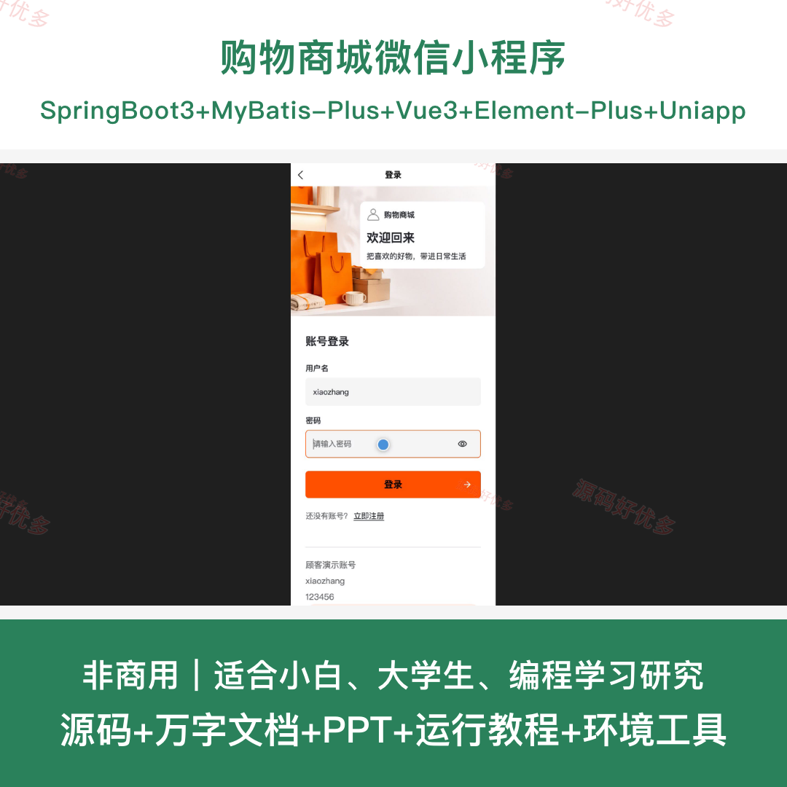
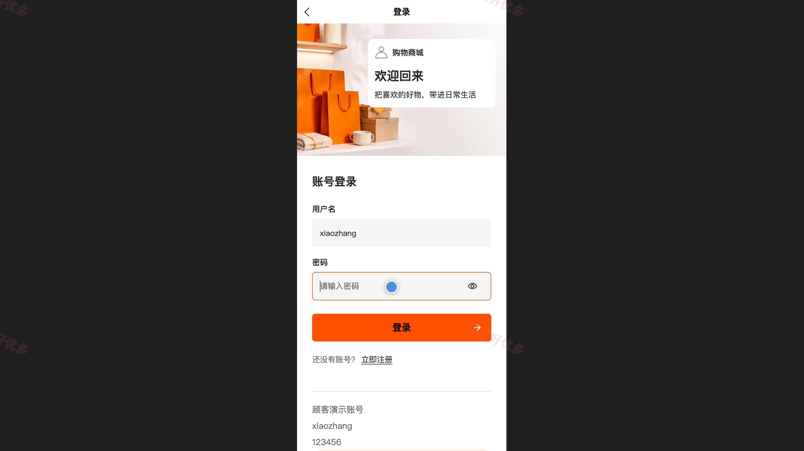
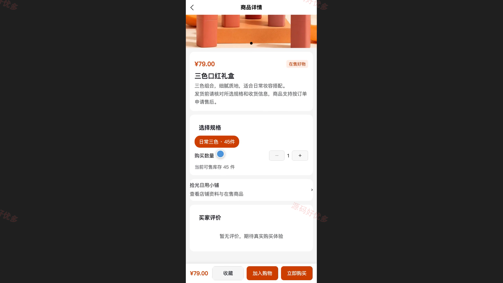
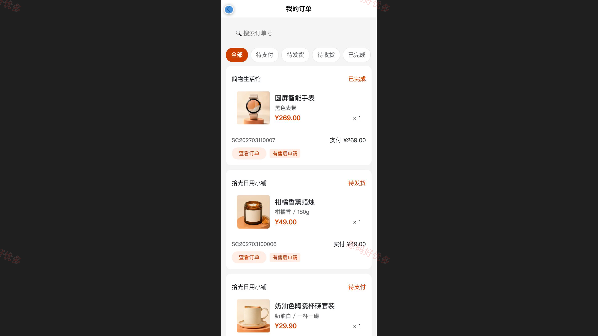
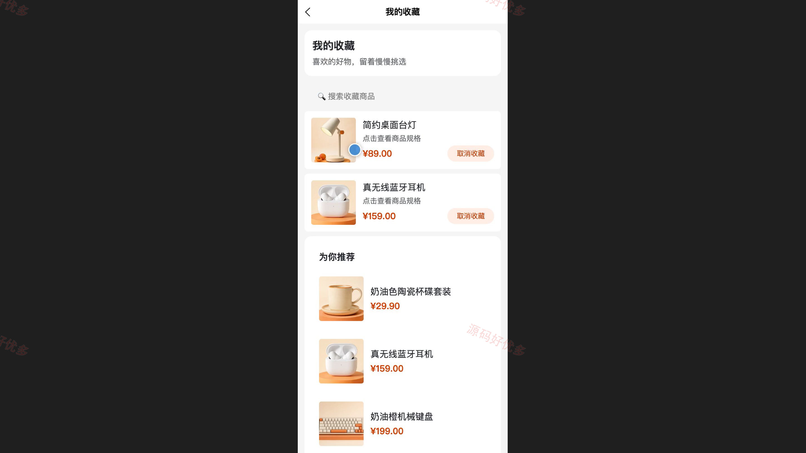
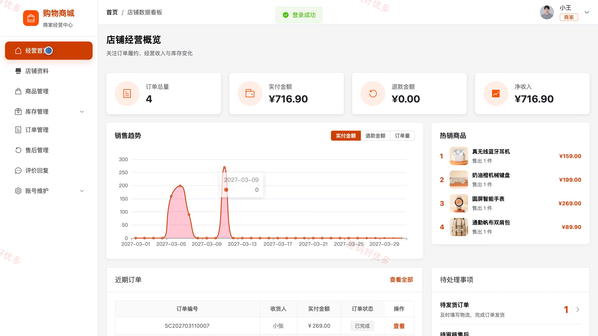
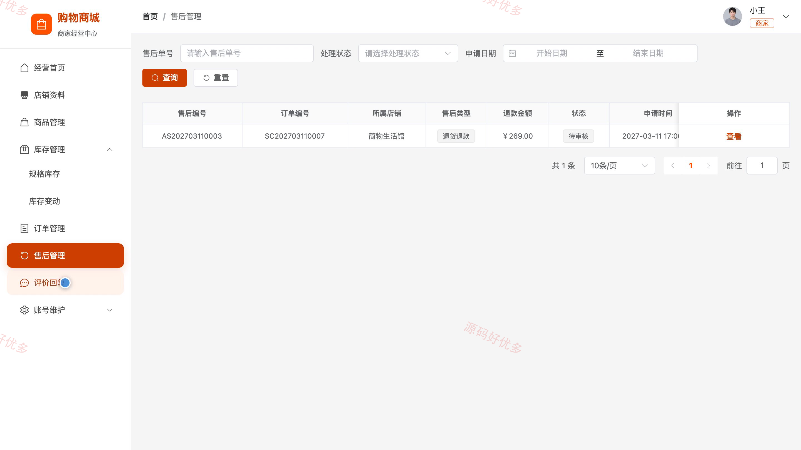
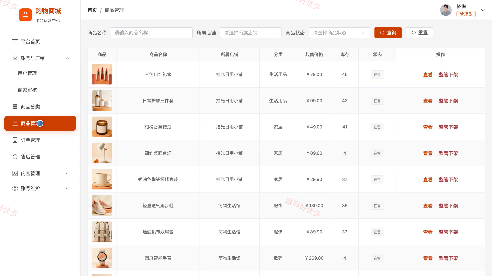

# bs002B
bs002B购物商城小程序源码 Java SpringBoot3 Vue3 设计文档 PPT
## 源码问题查看主页咨询

### 一、关键词
电商购物、在线商城、商家入驻、商品选购、订单售后

### 二、作品包含
源码+数据库+万字设计文档+PPT+全套环境和工具资源+本地部署教程

### 三、项目技术
前端技术： Html、Css、Js、Vue3.4、Element-Plus、uniapp
后端技术：Java、SpringBoot3.2.0、MyBatis-Plus

### 四、运行环境（以下版本亲测，其他版本兼容性请自行测试）
开发工具：IDEA/eclipse + VSCODE + HBuilder X + 微信开发者工具

数据库：MySQL5.7+（共18张表）

数据库管理工具：Navicat10以上版本

环境配置软件： JDK17 + Maven3.6

前端Nodejs：20.19.5

浏览器：谷歌浏览器

### 五、项目介绍
项目编号：bs002B

面向顾客、入驻商家与平台管理员的微信商城系统。顾客可在小程序中完成商品搜索、收藏、购物车结算、订单跟踪、评价和售后申请；商家通过管理端维护店铺、商品、库存、订单和售后；管理员负责商家审核、商品监管、内容维护及平台统计。

角色：顾客、商家、管理员

顾客功能：注册登录、商品分类搜索与详情查看、商品收藏与个性化推荐、购物车与收货地址管理、订单结算与模拟支付、订单状态跟踪及取消与确认收货、评价晒单、退款退货售后。

商家功能：入驻申请与店铺资料维护、商品及规格上下架、库存预警与变动记录、订单发货与物流填写、退款退货审核与库存回补、商品评价回复、销售统计与销量排行、账号资料与密码维护。

管理员功能：顾客与商家账号管理、商家入驻审核与店铺停用、商品分类与违规商品监管、平台订单与发货记录查询、售后记录与处理进度监督、轮播图与商城公告维护、平台销售趋势与热销商品统计、个人资料与密码维护。

### 六、运行截图

